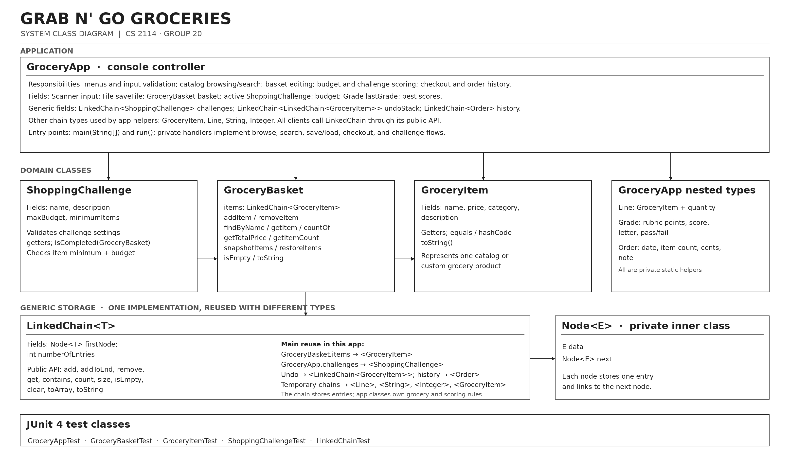

# Grab n’ Go Groceries
## CS 2114 — Project 2: Building for Reuse — Group 20

Grab n’ Go Groceries is a Java console application for managing a grocery basket and completing shopping challenges within a budget.

**Team:** Nikita Polstyanko, Kathy, Aleysa, and Miller

**Repository:** https://github.com/kathyjd08/CS2114_project2_Group20

## Features

- Browse a predefined grocery catalog organized by aisle.
- Search the catalog and add custom grocery items.
- Add and remove groceries, including duplicate items.
- View quantities, item counts, and the basket total.
- Set a budget and track remaining spending.
- Complete shopping challenges with item and budget requirements.
- Submit a basket for challenge scoring and feedback.
- Undo basket changes.
- Check out with a tax estimate and view order history.
- Save and restore progress.
- Receive feedback for invalid menu entries and invalid custom-item input.

## Project Structure

Source code and JUnit tests are located in:

`GrabnGoGroceries/src/grabnGoGroceries/`

| Class | Responsibility |
|---|---|
| `GroceryApp` | Runs the console interface and coordinates input validation, browsing, searching, budgeting, challenges, checkout, saving, and history. |
| `GroceryBasket` | Manages grocery items and provides adding, removing, searching, counting, totaling, and snapshot operations. |
| `GroceryItem` | Represents a grocery product with a name, price, category, and description. |
| `ShoppingChallenge` | Stores challenge requirements and checks whether a basket meets its minimum item count and maximum budget. |
| `LinkedChain<T>` | Provides reusable generic linked storage through its public API. |

`GroceryApp` contains three private static helper classes:

- `Line`: represents a grocery item and its quantity for basket display.
- `Grade`: stores challenge scoring information.
- `Order`: stores information about a completed checkout.

`LinkedChain<T>` contains a private static `Node<E>` class. Each node stores one entry and a reference to the next node.

## Generic LinkedChain Reuse

The application reuses one generic `LinkedChain<T>` implementation with multiple element types.

The two main examples are:

```java
// In GroceryBasket:
private LinkedChain<GroceryItem> items;

// In GroceryApp:
private final LinkedChain<ShoppingChallenge> challenges;
```

The same storage implementation therefore supports both grocery products and shopping challenges.

The application also uses:

- `LinkedChain<LinkedChain<GroceryItem>>` for undo snapshots.
- `LinkedChain<Order>` for order history.
- Temporary chains containing `GroceryItem`, `Line`, `String`, or `Integer` values.

Application classes use the chain’s public methods, including `add`, `addToEnd`, `remove`, `get`, `count`, and `size`. They do not access its private nodes.

`LinkedChain<T>` handles storing and retrieving entries. Grocery rules, budget calculations, and challenge scoring remain in the application classes.

## System Diagram



## Requirements

- Java Development Kit (JDK) 8 or later.
- Eclipse with Java development support, if following the Eclipse instructions.
- JUnit 4 for running the tests.

The committed Eclipse configuration references these files relative to the `GrabnGoGroceries` project folder:

- `lib/junit-4.13.2.jar`
- `lib/hamcrest-core-1.3.jar`

If these JAR files are not present, use Eclipse’s JUnit 4 library as described below.

## Compile and Run in Eclipse

1. Clone or download this repository.
2. In Eclipse, select **File → Import → General → Existing Projects into Workspace**.
3. Select the repository’s `GrabnGoGroceries` folder as the project root and import that Java project.
4. Ensure an installed JDK is configured for the project.
5. Open **Project → Properties → Java Build Path → Libraries**.
6. If the JUnit and Hamcrest entries are marked as missing, remove those missing entries.
7. Choose **Add Library → JUnit → JUnit 4** and apply the changes.
8. Select **Project → Clean** and rebuild the project. If automatic building is disabled, select **Project → Build Project**.
9. Open `src/grabnGoGroceries/GroceryApp.java`.
10. Run it as a **Java Application**.
11. Enter commands in the Eclipse Console.

The application displays its menu when it starts. Enter `help` to see available commands and shortcuts.

## Compile and Run from a Terminal

These commands compile the application classes without compiling the JUnit test files.

From the repository root:

```sh
cd GrabnGoGroceries
mkdir out
javac -d out src/grabnGoGroceries/GroceryApp.java src/grabnGoGroceries/GroceryBasket.java src/grabnGoGroceries/GroceryItem.java src/grabnGoGroceries/ShoppingChallenge.java src/grabnGoGroceries/LinkedChain.java
java -cp out grabnGoGroceries.GroceryApp
```

If the `out` directory already exists, skip the `mkdir out` command.

By default, the application saves progress to `.grabngo_save.properties` in the user’s home directory.

To use a different save file:

```sh
java -Dgrocery.save=demo-save.properties -cp out grabnGoGroceries.GroceryApp
```

## Run the JUnit Tests

Configure JUnit 4 using the Eclipse setup instructions above.

Select the `grabnGoGroceries` package under `src` and run it as a **JUnit Test** to run the project’s tests.

| Test class | Main area tested |
|---|---|
| `GroceryAppTest` | Console flows, commands, input validation, challenges, checkout, saving, and restoring progress. |
| `GroceryBasketTest` | Basket operations, duplicates, item lookup, snapshots, restoration, and invalid arguments. |
| `GroceryItemTest` | Item properties, equality, hash codes, and string output. |
| `ShoppingChallengeTest` | Challenge requirements, invalid settings, and basket completion checks. |
| `LinkedChainTest` | Generic storage operations, invalid inputs, and reuse with different element types. |

A successful full run should report zero failures and zero errors. Run the entire suite after making code changes.

## Input Handling and Design Decisions

- Invalid menu entries produce feedback so the user can continue.
- Custom-item input is checked before an item is added.
- Adding a null item to a basket is rejected.
- Invalid basket indexes are rejected.
- Challenge settings require a valid name, a positive finite budget, and a minimum item count of at least one.
- Duplicate groceries are allowed. Removing a matching item removes one occurrence.
- Empty baskets can be displayed and checked.
- The console interface handles user input, while model methods enforce their own argument requirements.

## Changes from the Specification and Prototype

The original specification focused on manually entering grocery items and managing a basket. The implementation added a predefined catalog organized by aisle and catalog searching to make shopping faster.

Additional functionality includes budgeting, checkout with a tax estimate, saved progress, undo, order history, and challenge grading.

The application’s constructors accept a `Scanner`, with an optional `File` for saving progress. This allows tests to provide controlled input and temporary save files.

The prototype README described tests as future work. The repository now includes five JUnit test classes, including tests for quitting from menus and resubmitting challenges after basket changes.

### LinkedChain Contract

Our initial design assumed a chain with both head and tail references. The provided implementation instead uses a first-node reference and an entry count.

`add()` inserts at the beginning of the chain. To preserve grocery insertion order, `GroceryBasket` calls `LinkedChain.addToEnd()`.

This required us to understand the provided contract and build application behavior around its public API.

## Development Reflection

Dividing the project into classes helped separate the console interface, basket operations, grocery data, challenge requirements, and reusable storage.

A challenge during development was keeping method signatures and class responsibilities consistent as features were added. Changes to one class could affect the classes and tests that depended on it.

Committing to a generic contract meant deciding what the storage class should promise before every application feature was finished. We needed to understand insertion order, removal behavior, duplicates, and invalid arguments.

Our understanding of reuse became more concrete through the project. A reusable class needs a clear contract that different clients can rely on. Generics allowed us to use the same linked-storage code with different element types while retaining type checking.

## Stretch Features and Limitations

Beyond the core basket operations, the implementation includes catalog browsing and searching, saved progress, undo, checkout, order history, and challenge scoring.

The proposed coupon system was not implemented and remains a possible future extension.

Catalog searching searches predefined products. It does not provide a separate searchable catalog of custom items.

The application uses a text interface and local save files. Its prices and tax estimate are intended for the project demonstration.

## Attribution

Nikita led the coding work, with Kathy providing code review and additional programming assistance. Aleysa developed the presentation slides, and Miller prepared the written reflections and project writeups.

The table below reflects these overall development and review roles; it does not imply equal contributions to every file.

| File | Contributor(s) | Contribution |
|---|---|---|
| `GroceryApp.java` | Nikita; Kathy | Primary development by Nikita, with review and additional code assistance from Kathy. |
| `GroceryBasket.java` | Nikita; Kathy | Primary development by Nikita, with review and additional code assistance from Kathy. |
| `GroceryItem.java` | Nikita; Kathy | Primary development by Nikita, with review and additional code assistance from Kathy. |
| `ShoppingChallenge.java` | Nikita; Kathy | Primary development by Nikita, with review and additional code assistance from Kathy. |
| `LinkedChain.java` | CS 2114 Staff; Nikita; Kathy | Instructor-provided implementation, integrated into the application by Nikita with review and assistance from Kathy. |
| `GroceryAppTest.java` | Nikita; Kathy | Test code development and revision, with Nikita leading the coding work and Kathy providing review and assistance. |
| `GroceryBasketTest.java` | Nikita; Kathy | Test code development and revision, with Nikita leading the coding work and Kathy providing review and assistance. |
| `GroceryItemTest.java` | Nikita; Kathy | Test code development and revision, with Nikita leading the coding work and Kathy providing review and assistance. |
| `ShoppingChallengeTest.java` | Nikita; Kathy | Test code development and revision, with Nikita leading the coding work and Kathy providing review and assistance. |
| `LinkedChainTest.java` | Nikita; Kathy | Test code development and revision, with Nikita leading the coding work and Kathy providing review and assistance. |

### Other Project Contributions

- **Nikita Polstyanko:** Led application development and coordinated the project.
- **Aleysa:** Created and organized the presentation slides.
- **Miller:** Prepared project writeups and written reflections.
- **Kathy:** Reviewed the project, contributed diagrams, and provided additional coding assistance.

## GenAI Use and Reflection

GenAI assisted with project organization, code-structure suggestions, explanations of Java concepts and errors, and GitHub and Eclipse setup guidance. It also assisted with reviewing assignment requirements and drafting or revising the system diagram and README.

Human contributions listed above include directing, reviewing, and revising AI-assisted work. The team remains responsible for understanding the submitted implementation, checking its behavior, and accurately describing its capabilities.

Verification involves comparing suggestions with the actual source code and assignment requirements, reading the resulting implementation, exercising program features, and running the JUnit tests.

One risk of over-reliance is accepting a fix without understanding why it works. This can make it harder to explain the implementation, identify new bugs, or help a teammate understand the code. It can also reduce opportunities for teammates to practice.

For future work, we would provide relevant code and context, ask focused questions, and request explanations of proposed changes. We would involve teammates in reviewing changes so that everyone understands the parts they need to present and defend.
